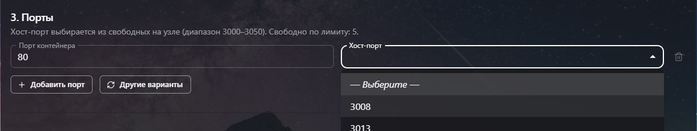
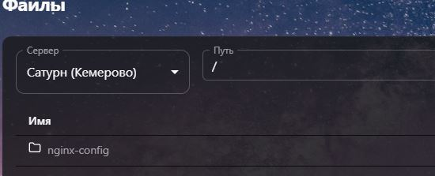
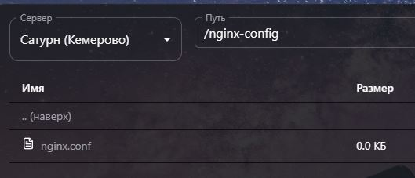
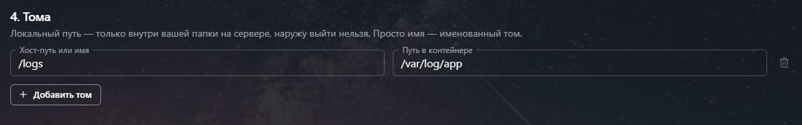
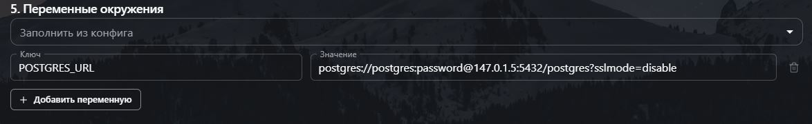

# Что за контейнеры?

**Docker-контейнер** - это аквариум, со своей внутренней экосистемой, существующий независимо от внешнего мира, имеющий все необходимое для самостоятельного существования.

В контейнере уже лежат все необходимые зависимости вашего проекта и окружения, главный принцип докера, в том, что его можно запустить везде где есть докер, и будет работать одинаково, независимо от исполняемой среды.

Финальный результат сервиса - запущенный контейнер на сервере, но чтобы его собрать нужно создать Dockerfile.

**Dockerfile** - текстовый файл с пошаговой инструкцией, как собрать этот контейнер.

# Внешние и внутренние порты

Важно понимать что является внутренним и внешним портом, контейнера, так как если вы просто укажите что ваш контейнер должен работать на 3001 порту в обоих случаях, то ничего не получится.

---
**Внутренний порт** - это порт, на котором запущено приложение внутри контейнера (например, веб-сервер на 80 или база данных Postgre на 5432). Этот порт нужно явно указывать в коде вашей программы. 

Например, если вы делаете React приложение и пропиши в vite.config.ts, что он должен запускаться на 80 порт (база), то он не запустится, так как для таких случаев нужен nginx или appache, которые будут слушать этот 80, и это нужно указать в Dockerfile. Вот пример: https://github.com/xufengsong/reactjs-sample, но лучше обратиться к какому-нибудь DeepSeek (описав стек приложения) или OpenCode сгенерить его, чтобы долго с этим не возиться.

---

Внешний порт - это порт, который слушает внешний мир и может обращаться к сервису внутри контейнера. Запросы приходят на внешний порт сервера, а затем перенаправляются внутрь контейнера.

Порт контейнера может быть любым, а вот внешний порт только в ограниченном сервисе диапазоне.

# Что такое тома (они же volumes)?
Это сложный механизм монтирования папок и файлов, который лучше представить немного по-другому:

Есть мир внутри контейнера (как правило берём образ Linux Alpine), мы знаем где что там располагается, но чтобы что-то в нём поменять нам нужно создать копию объекта, реагирующую на наши изменения в нашем мире. 

Например: есть у нас конфиг Nginx в контейнере и нам нужно его в дальнейшем менять. Первым делом создадим папку `nginx-config`, в который будем ложить наш конфиг:

Создали, теперь условно создали наш nginx конфиг и загрузили его:

Теперь в вашей личной папке есть файл, который находится по пути `/nginx/config/nginx.conf`.

По дефолту, все конфиги nginx в linux лежат по пути `/etc/nginx/conf.d`, там же лежит `nginx.conf` (это общий конфиг), значит чтобы нам в будущем редачить конфиг nginx мы делаем следующую запись (все настройки можно поменять будет уже в работающем приложение в панели управления):

Всё, при запуске контейнера, он будет подхватывать из папки этот конфиг.

## Главное чтобы путь существовал на сервере, где вы разворачиваете приложение, обязательно проверяйте его.

Также и наоборот, допустим у вас приложение пишет логи внутри контейнера, и вы хотите их читать в разделе `файлы`, то для этого делается условно такая запись:

Тоесть, всё что будет писаться в `/var/log/app` в контейнере вы будете видеть в разделе `файлы` в `/logs`.

# Что за переменные окружения?

У вас 90% есть или был файл под названием `.env` в котором прописывались все секреты, пароли и тому подобное, вот это оно и есть, если у вас конфиг в виде какого-нибудь `yml`, то лучше примонтировать его через тома, а если есть `.env` или приложение просто подхватывает переменные окружение при старте, то лучше использовать это.

Здесь пишутся просто ключ и значение. Пример строку подключения к БД:

