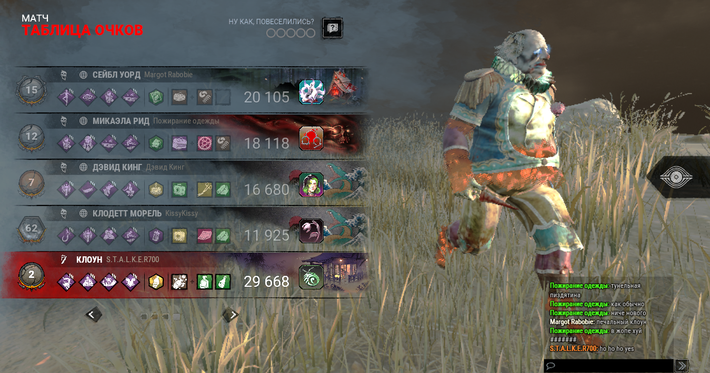

# Деплой и обновления

## Переменные окружения

Создайте до **10** конфигов в **Env Configs**:

```env
NODE_ENV=production
DATABASE_URL=postgres://...
PORT=3000
```

При создании контейнера выберите конфиг — он подставится как `docker run --env`.

## Порты

Лимит — **5 портов** на пользователя. Виджет **Порты пользователя** показывает:

- Занято / свободно
- Какой контейнер занимает порт

Освободите порт, удалив контейнер или перевыпустив его.

## Volumes

Volumes теперь внутри настроек контейнера:

- **ApplicationDetails → Settings** или **ContainerDetails → Volumes**
- Укажите имя и `mountPath` (например `pg-data:/var/lib/postgresql/data`)

Старый раздел **Volumes** в меню скрыт, но доступен по прямой ссылке.

## Логи и отладка

- **ContainerDetails → Логи** — поиск, копирование, скачивание `.log`
- В реальном бэкенде логи стримятся по WebSocket

## Скриншоты



