# Быстрый старт

## 1. Создадим приложение по шагам

Будем использовать простой репозиторий https://github.com/pixfid/portfolio-website

Первым делом нажимаем `создать приложение` в разделе `приложения`
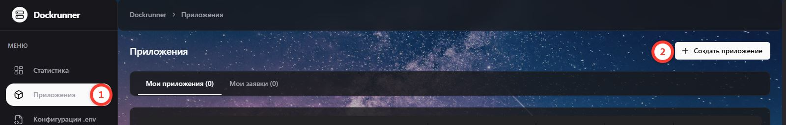

Назовём его условно `my-first-deploy` и укажем ссылку на репозиторий

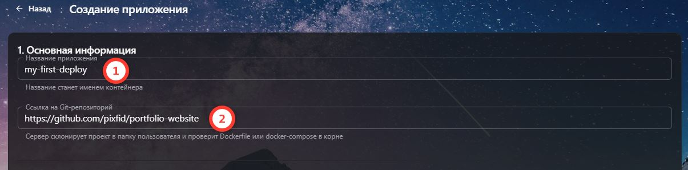

На выборе сервера лучше довериться автоматическому выбору

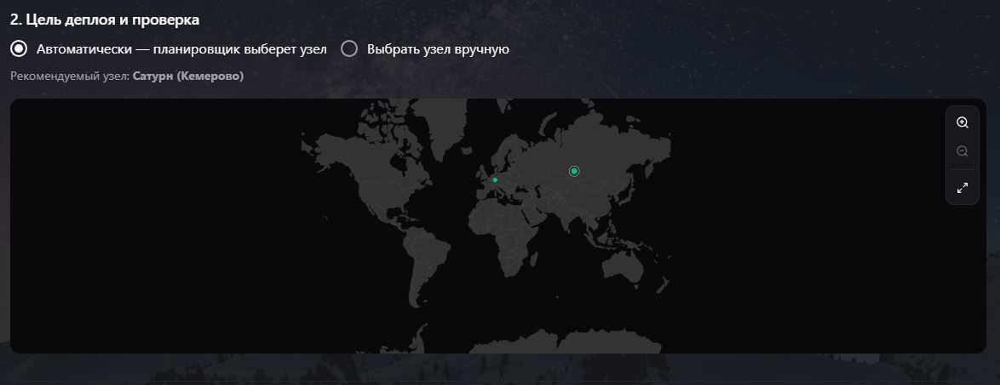

Теперь надо узнать на каком порте должно работать приложение, чтобы указать внутренний и внешний порт.
В репозитории автора мы видим, что он работает на 8080 порту, благодаря строчке `EXPOSE 8080` в Dockerfile, на самом деле она никакой роли не играет при билде, она как маркер людям и сервисам какой порт используется внутри приложения.

Так как наш диапазон только в пределах 3000 - 3050, то возьмём случайный порт и получим:

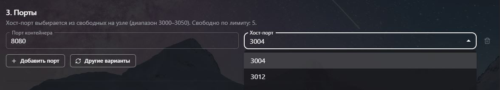

Тоесть, приложение будет доступно в мире через порт 3004.

Больше никаких настроек нам не надо, поэтому нажимаем на `Проверить репозиторий`

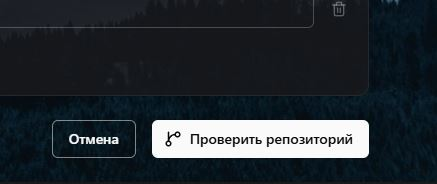

Сервис его скачает и проверит на наличие Dockerfile или `docker-compose.yml`, если всё ок, то выдаст следующее окно:

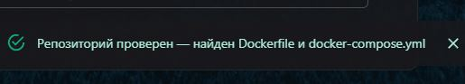

Также во 2 пункте, под картой, будет написано какие контейнеры будут запущены

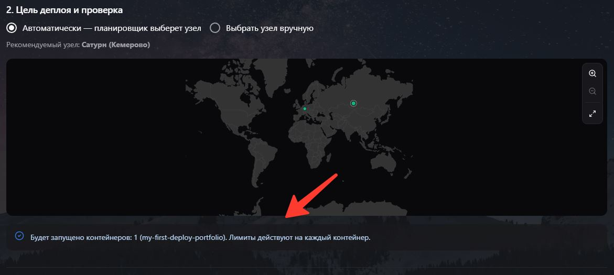

Дальше от вас требуется спуститься в самый низ и подтвердить заявку, которую рассмотрит модератор.

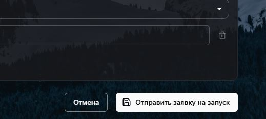

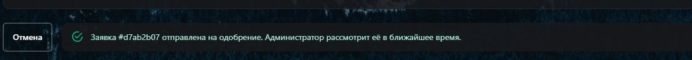

## 2. Проверьте деплой

Вы можете отслеживать статус заявки через раздел `Приложения`

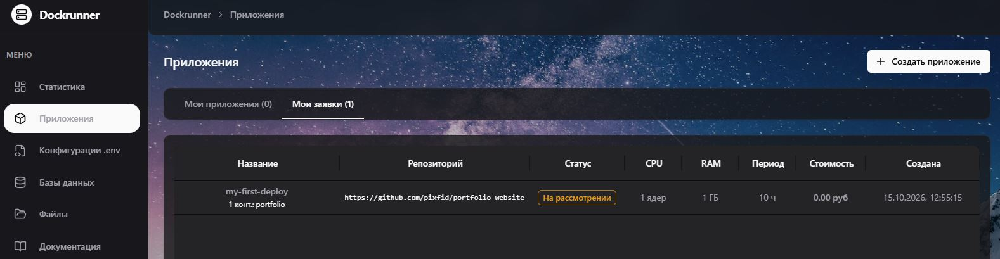

Допустим, админ одобрил, приложение появится в вашем списке приложений, только после успешного запуска!

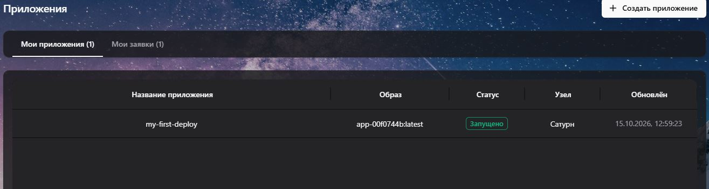

Можно также в реальном времени смотреть логи контейнера

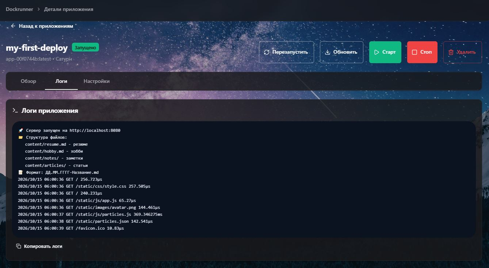

Конечный результат

